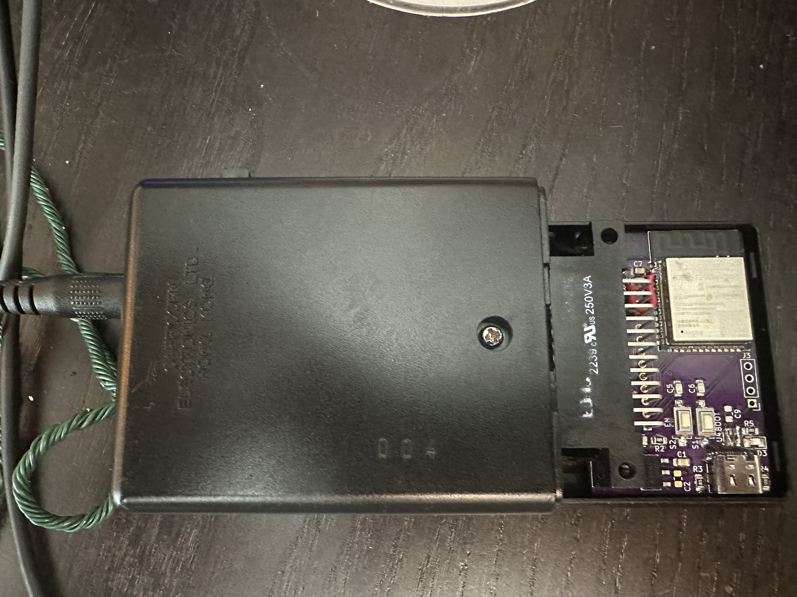
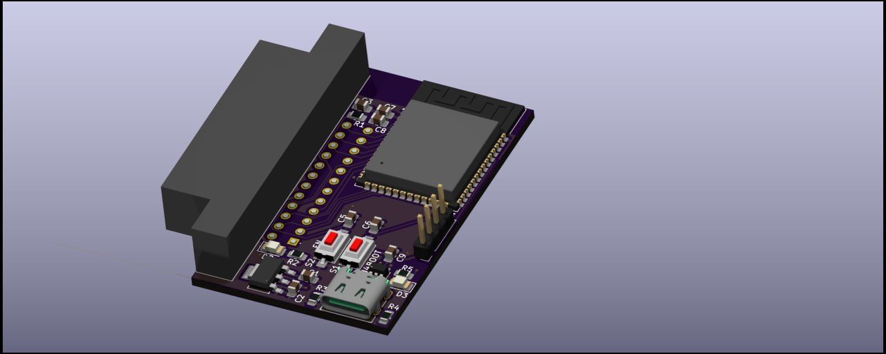

# Merrie Minstrel Choir

An ESP32-based replacement for the "Ye Merrie Minstrel Caroling Christmas Bells" original ROM cartridge featuring wireless synchronization.  Every unit carries the same song library, and any number of units on the same Wi-Fi network play in unison, creating a choir of christmas bells.

<p align="center">
  
</p>

## Overview

This project provides open-source firmware and hardware designs to replace the original ROM cartridge in Ye Merrie Minstrel handheld bell units. Using ESP-NOW wireless communication, multiple sets of bells can be synchronized to play together in a choir.  The PCB is meant to be a direct drop-in replacement to the original ROM cartridge, no modifications of the device is required.  I reccomend a power adapter with a larger current capacity than the original 200mA to compensate for the extra power comsumption of the ESP32.

I used [OSH Park](https://oshpark.com) to manufacture the PCBs.  

## Project Structure

```
├── firmware/           # Bell-unit firmware (Arduino sketch): Wi-Fi control page, songs, UDP group sync
│   └── rom-dumper/     # Firmware for dumping ROM contents over a serial connection
├── hardware/
│   └── merrie-minstrel-choir/  # KiCad PCB design files
├── tools/              # Python package: song library (roms/), new songs (songs/), song and bell tools, sync monitor
└── docs/
```

## Hardware

The custom PCB is designed in KiCad and interfaces with the original bell unit via a 24-pin edge card connector, replacing the ROM cartridge.

<p align="center">
  
</p>

## Demo

[View operation video](https://youtube.com/shorts/tzY3T9JohGE?feature=share)

## Firmware

### Minstrel
Each bell unit runs the minstrel firmware. It plays its compiled-in song library by driving the 12-bit parallel data bus to the bell's solenoids. A phone sets it up and controls it through a web page, and units on the same network keep a shared clock over UDP so they play together. It also takes strikes over USB serial, for developing songs. See `firmware/README.md`.

### Rom Dumper
The original ROM contains copyrighted material.  I don't have permission to share the contents.  You can acquire your own ROM cartridge and dump the ROM using the Arduino program provided.


## Requirements

- ESP32 development boards
- Arduino IDE with ESP32 board support
- KiCad (for hardware modifications)

## License

This project is licensed under the MIT License - see the [LICENSE](LICENSE) file for details.
